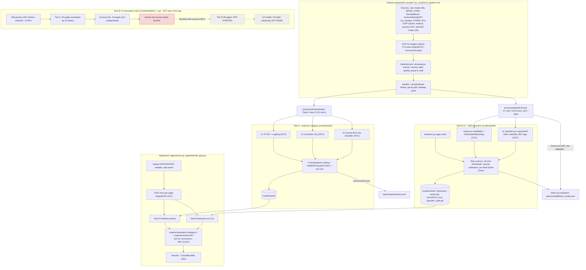

# HR Bill Classifier - Examiner Project Walkthrough (audit of the actual repository)

Written 2026-10-11 after reading the code, the saved models, the metric files and the app as they exist now. Evidence tags used throughout:
**[V]** verified in code or a saved artifact (path given) - **[H]** historical report figure (reproduced from a saved report, not re-run) - **[O]** observed manual test - **[P]** planned / incomplete / blocked - **[U]** unverified.
No model was trained or re-evaluated for this document; every number below was read from a file or a log that exists in the repository. Where documents or earlier statements disagree, the discrepancy is stated (section 18).

---
## 1. Executive summary
The project turns a photo or PDF of a bill into (a) an **expense category** (Task A: *what was the money spent on?*) and (b) **structured bill fields** (Task B: vendor, invoice number, date, GSTIN, totals, taxes...), shows both with the OCR text in a web UI, and files the original bill in `outputs/classified/<category>/`.

What is real today [V]:
- A built dataset of **8,183 documents (5,753 real + 2,430 synthetic)** with provenance, licence, country, label quality and leakage-controlled group splits (`datasets/metadata/manifest.jsonl`).
- **Task A**: three models (TF-IDF+logistic regression on OCR text, ConvNeXt-Tiny on the image, LayoutLMv3 on text+layout+image) fused with per-model temperature scaling, plus an HR-routing threshold tau = 0.61. Real-test accuracy **0.907**, macro-F1 **0.839** (`reports/taskA/fusion.json`).
- **Task B V1**: a hybrid of a regex baseline, a candidate ranker and a LayoutLMv3 token classifier, chosen per field on real validation data. Real-test micro-F1 **0.663**, macro-F1 0.578 (`docs/TASK_B_REPORT.md` section 10, `reports/taskB/final_results.json`). The report itself calls it a *research prototype*.
- A **Streamlit app** (`app/`) that runs the whole chain; a 26-check backend self-test passes.

What is not finished [P]: Task B **V2** (real Indian GST invoices, list-valued HSN/SAC, extra tax fields) - 54 pages annotated by an AI annotator, **independent human QA is blocked** (answer sheet is blank, verified today); no V2 model exists. Real `rent` documents do not exist. Task B's Indian GST fields are supported by only a handful of real test documents.

## 2. Problem statement and objectives
An HR team receives expense claims as photographs/PDFs of bills. Reading each one manually is slow and error-prone. Objectives implemented: (1) categorise the spend, (2) pull out the amounts and identifiers needed to check the claim, (3) route uncertain claims to a human instead of auto-approving them (calibrated confidence + threshold), (4) keep a browsable filing of processed bills. Indian bills (GST) are the focus; foreign real receipts were deliberately used where Indian data was not available.

## 3. Approved scope: Task A and Task B only
Only Task A and Task B are in scope. OCR is a shared pre-processing component, not a task. Other task labels that appear in older project files (e.g. `datasets/processed/document_type/`, `datasets/processed/anomaly/`) are outside the approved scope and are not used by anything described here.

## 4. Architecture


The V1 path (data -> models -> app) is complete; the V2 track is separate and does not feed the app.

## 5. Dataset construction and data quality
### 5.1 Pipeline [V]
`scripts/run_pipeline.sh` order: `download_datasets.py` -> `acquire_real_foreign.py` (subsets of ReceiptBench and InvoicesReceiptsPT) -> `generate_synthetic_data.py` (seed 42) -> `build_dataset.py` (manifest_raw + per-document annotation JSON with `words[{text,bbox}]`, `fields`, `ocr_source`) -> `run_ocr.py` (RapidOCR for real images lacking ground-truth OCR) -> `detect_language.py` -> `normalize_labels.py` (keyword labels for unlabeled utility bills + 90 human label fixes from `datasets/metadata/label_overrides.json`) -> `deduplicate.py` (exact sha256; near-duplicate if pHash<=4 or (pHash<=6 and dHash<=8); merchant/layout grouping; synthetic images excluded from near-dup search) -> `create_splits.py` (group-level stratified 80/10/10, so no template family crosses splits) -> `validate_dataset.py` (task views, stats, hard checks) -> `audit_leakage.py` (independent nearest-neighbour pHash audit).
### 5.2 Counts, verified from `datasets/metadata/manifest.jsonl` today [V]
| quantity | value |
|---|---|
| manifest rows (after dedup, nothing dropped at this stage) | **8,183** |
| real / synthetic | **5,753 / 2,430** |
| all-task split train / val / test | 6,548 / 821 / 814 (real 4,604 / 578 / 571) |
| Task A trusted-label view (`processed/classification`) | **6,111** = 3,681 real + 2,430 synthetic; train/val/test 4,848 / 634 / 629 (real 2,904 / 391 / 386) |
| unlabeled (no expense category; CORD, unmatched SROIE, etc.; excluded from Task A, used by Task B) | 2,072 |
| Task B frozen V1 view (`processed/taskB`) | **6,442** = 2,932 real + 3,510 synthetic; train/val/test 5,160 / 646 / 636 (real 2,352 / 295 / 285) |
| real documents tagged India | 837 (Task B: 285 Indian-real = 232 / 26 / 27) |
| hard negatives flagged | 483 (180 synthetic non-expense look-alikes + 303 real) |
Real sources (count): my_receipts 1,162, CORD 998, SROIE 958, ReceiptBench 867, in_financial 390, manual_in (your Indian bills) 368, RVL-CDIP 320, FUNSD 199, user_real 198, in_grocery_gst 169, InvoicesReceiptsPT 109, hf_medical 15. Label quality: synthetic 2,430, source_label 2,260, unlabeled 2,072, rule_high 773, manual_folder 565, manual_review 83.
### 5.3 Which dataset figure is which (do not conflate)
- **8,183 / 5,753 / 6,548-821-814**: the full current manifest (all tasks). The figures *7,924 / 5,494* in `docs/DATASET.md`, `DATA_QUALITY_REPORT.md`, `REAL_DATA_ACQUISITION_2026-10-04.md` (line 31) are the manifest **before** a later round that added 260 India-tagged ReceiptBench documents (the same file, line 94, states the new total 8,183 = 5,753 + 2,430). The split *6,340 / 795 / 789* sums to 7,924 but does not appear in any `docs/*.md` file (searched for 6,340 / 6340); treat it as unverified/stale.
- **6,111**: Task A only (labelled documents).
- **6,442 (2,932 real + 3,510 synthetic)**: not a historical or abandoned snapshot - it is the **current frozen Task B V1 dataset** (`datasets/processed/taskB/*.jsonl`, and the identical copy in `reports/taskB/v1_snapshot/`). It is made of SROIE 958 + CORD 998 + ReceiptBench 867 + PT 109 + synthetic_in 2,430 + synthetic_b 1,080 = 6,442 (`docs/TASK_B_REPORT.md` section 3). It differs from the 8,183 because Task B uses only sources that have field annotations.
- An older `processed/information_extraction` view (5,561 docs) exists but the final Task B does not use it.
### 5.4 Real vs synthetic, and why it matters
Synthetic Indian bills (`generate_synthetic_data.py`, `taskB/generate_synthetic_b.py`) are rendered from a few templates with exact OCR boxes and labels; they fill categories and fields for which no real labelled data exists (rent, HSN/SAC, hotel stay, medical, ...). They help training a little (Task A text model, real accuracy 0.883 with synthetic vs 0.871 without - `reports/taskA/text_baseline.json`) but every model scores ~1.0 on them (Task A synthetic test accuracy 1.000), so **they cannot measure real-world quality**. All headline metrics in this project are therefore real-only; synthetic results are reported separately.
### 5.5 Leakage control [V]
Groups are never split. `datasets/metadata/leakage_audit.json`: real val 579 docs - 31 have a train neighbour at pHash distance <=8, **0 at <=4**; real test 571 docs - 36 at <=8, **0 at <=4**. Augmentation is never written to disk (`scripts/augment.py` docstring), so it cannot leak. The Task B V1 test file is frozen (sha256 `fd8bafb3ad13...`, verified today).
### 5.6 Coverage and gaps [V]
Real per class (Task A): food 960, misc 430, non_expense 802, train 286, hotel 222, transport 148, electricity 120, flight 131, bus 132, fuel 136, parking 81, water 71, internet 63, medical 59, gas 40, **rent 0** (`docs/DATASET_STATS.md`). Real **test** support is tiny for several classes (gas 4, internet 6, medical 6, water 7, parking 8). Real Indian documents by category: miscellaneous 172, food 104, electricity 90, train 65, hotel 61, transport 60, bus 59, water 55, flight 48, fuel 43, gas 33, parking 22, medical 20, internet 5. Earlier gaps in Indian transport/hotel/flight/bus/medical were partly filled by India-tagged ReceiptBench receipts (these are tickets and hotel bills, not GST retail invoices). Task B Indian GST evidence is thin (section 8).

## 6. Task A - expense classification
### 6.1 Taxonomy [V] (`docs/TAXONOMY.md`, `scripts/common.py: CATEGORIES`)
16 labels: bus, electricity, flight, food, fuel, gas, hotel, internet, medical, miscellaneous, non_expense, parking, rent, train, transport, water. `transport` = cab/auto/ride-hailing **and metro/tram tickets**. `food` = restaurants/cafes/meals (my_receipts food: restaurant 214, cafe 59...). `miscellaneous` = office supplies, equipment, **groceries**, retail, subscriptions (manifest sub-categories: grocery 169, retail 105). `non_expense` = letters/forms etc. so a non-bill can be rejected. There is **no grocery category**. Labels are flat; `parent_group` (travel, utilities, ...) is metadata.
### 6.2 Inference path [V] (`scripts/taskA/predict.py`, `Predictor`, lines 16-60)
1. OCR (`ocr()` l.11 -> `run_ocr_gpu.get_engine`, RapidOCR, max side 1600) gives words+boxes.
2. `logits()` l.30: **text model** `models/taskA/text_lr.joblib` (TF-IDF char 2-5 + word 1-2 -> logistic regression, C=10, class-balanced; trained by `t1_text_baseline.py`); **image model** `convnext_tiny.pt` (timm ConvNeXt-Tiny, 384-px letterboxed, 14 epochs, AdamW + OneCycle, class-weighted label-smoothed CE, train-only photometric+geometric augmentation, real docs sampled 2x - `t2_image_convnext.py`); **LayoutLMv3** `layoutlmv3.pt` (`LayoutLMv3ForSequenceClassification`, up to 448 tokens, boxes normalised to 0-1000, 6 epochs, effective batch 16 = 2x8 accumulation, bf16, photometric augmentation only - `t3_layoutlmv3.py`).
3. `predict()` l.47: each model's logits are divided by its **temperature** (text 0.603, image 0.802, layoutlm 0.932), softmaxed, combined as a **weighted sum of log-probabilities** (weights text 0.5 / image 0.3 / layoutlm 0.2, chosen by validation NLL per the `t4_fusion_calibration.py` docstring), divided by a fused temperature (0.833), softmaxed again. Output: label, parent group, confidence = max probability, top-3, and `route` = `auto` if confidence >= **tau 0.61** else `hr_review`. All of these constants live in `models/taskA/fusion.json`.
4. Class index -> label: `LABELS = sorted(CATEGORIES)` (`common_a.py`); the same list is stored in `fusion.json["labels"]`. No fallback label exists in this path.
5. tau rule: smallest threshold whose accepted validation-real precision >= 0.95 (needs >=30 accepted docs) - test is not used.
### 6.3 Results [H, from `reports/taskA/fusion.json`, `text_baseline.json`, `docs/TASK_A_REPORT.md`]
Real test documents (n = 386):
| model | accuracy | macro-F1 |
|---|---:|---:|
| TF-IDF + LogReg | 0.883 | 0.831 |
| ConvNeXt-Tiny | 0.800 | 0.627 |
| LayoutLMv3 | 0.863 | 0.704 |
| **calibrated fusion** | **0.907** | **0.839** (95% CI 0.753-0.889) |
Fusion on real *Indian* test docs (n = 110): accuracy **0.955**, macro-F1 0.926, ECE 0.040. On *all* test docs (n = 629, incl. 243 synthetic) accuracy 0.943 - inflated by synthetic, so not quoted as the headline. ECE (calibration error) real: 0.020. Routing on real test: tau 0.61 auto-processes **93.0%** at **94.4%** precision; 27 of 386 go to HR. Group 5-fold CV of the text model on train+val: real accuracy 0.857, macro-F1 0.838.
Per class (real test, fusion): food 0.955 F1 (n=109), non_expense 0.970 (80), miscellaneous 0.922 (50), electricity 0.923 (12), parking 0.933 (8), fuel 0.917 (13), flight 0.889 (13), hotel 0.880 (23), transport 0.828 (14), train 0.756 (28; recall 0.607), bus 0.727 (13), water 0.727 (7), gas 0.857 (4), internet 0.800 (6), **medical 0.500 (6; recall 0.333)**, rent n/a. Most frequent real errors: train -> bus 6, food -> miscellaneous 3, water -> non_expense 2, medical -> miscellaneous 2, miscellaneous -> hotel 2.
### 6.4 How to read these numbers
Accuracy = share correct (dominated by big classes: food 109 of 386 real test docs). Macro-F1 = unweighted mean of per-class F1, so small weak classes (medical, bus, water) pull it down: that is why accuracy 0.907 but macro-F1 0.839. Aggregates hide classes with n<10 whose F1 swings by one document. The result shows: late fusion beats each single model on real data; the text signal is strongest; confidence is reasonably calibrated; Indian bills do well. It does **not** show: accuracy on `rent` (no real documents), accuracy on unseen merchants/layouts beyond the group-split design, or robustness to rotated/very different photos. Test sets for the weak classes are too small for firm claims.
### 6.5 The grocery-bill misclassification (investigated and fixed) [V]
- The bill that went to `miscellaneous` is a **restaurant** bill (Purgatory 777, pasta, table number, steward, service charge), not a grocery bill (`outputs/results/20261011T152119_81a58ad4/`).
- `miscellaneous` was the **model's genuine fused prediction** (0.458 vs food 0.441), not an application fallback: the record had no Task A error, labels/indices match, and Task A does not read Task B output. Per-model votes: text -> food 0.66-0.74, LayoutLMv3 -> food 0.94-0.95, **ConvNeXt (image) -> miscellaneous 0.97**.
- An integration defect pushed it over the line: the app re-saved uploads as JPEG before OCR, which changed some OCR characters ("Item" -> "ltem"), altering the text model's vote. Running Task A's own path on the original file gave **food 0.523**; the app gave miscellaneous 0.458.
- Fix (`app/service.py`): lossless working copy and OCR on the page file, as `scripts/taskA/predict.py::ocr` does. Re-run through the app: **food 0.523** (still < 0.61, so flagged `hr_review`); electricity/water/fuel/medical-PDF samples unchanged and saved in their predicted folders. Four grocery-GST invoices still go to `miscellaneous` (~0.999) - correct by taxonomy. The model, thresholds and datasets were not touched.
- Residual: the image branch is wrong for this receipt (known: food -> miscellaneous is a top-3 error in the report); fixing it needs retraining, which was not done. The earlier mis-filed upload still sits in `outputs/classified/miscellaneous/`.

## 7. Task B V1 - field extraction
### 7.1 Pipeline [V] (`scripts/taskB/predict.py`: `Extractor` l.22, `run` l.32, `load_input` l.51, CLI l.65)
| # | stage | file::function | in -> out |
|---|---|---|---|
| 1 | load image/PDF/doc-id | predict.py::load_input | path -> PIL image + OCR segments (PDF: page-1 raster `pdf_utils.rasterize` + text layer `pdf_utils.words`) |
| 2 | OCR | run_ocr_gpu_b.py::ocr_segments (-> taskA/run_ocr_gpu.get_engine) | image -> [{text, bbox}] |
| 3 | words + boxes | words.py::split_words, reading_order | segments -> words with proportional sub-boxes, reading order; labels glued to values ("GSTIN:08AB...") are split (`split_label`) |
| 4a | baseline | baseline.py::extract | words -> rule-based predictions |
| 4b | ranker | ranker.py::build_cands, predict_doc | candidates per field -> best candidate + score |
| 4c | LayoutLMv3 | ie_layoutlm.py::predict_probs; decode_ie.py::decode/spans_for | words+boxes+image -> per-word tag probabilities -> spans |
| 5 | thresholds + calibration | predict.py l.35, l.39 (`taus` and isotonic `iso` loaded from `ranker.pkl`, `layoutlm_calib.pkl`) | raw score -> kept or abstained; calibrated confidence |
| 6 | hybrid | predict.py l.41-46 with `models/taskB/hybrid.json["choice"]` | per field pick one system; fallback ranker, then baseline |
| 7 | derived | l.47 | IGST-only bill: tax_total = IGST (source "derived(igst)") |
| 8 | gating | gating.py::gate | drop hotel/travel/etc. fields lacking evidence words |
| 9 | JSON | l.46, 71-75 | `{value, raw_text, confidence, model_score, source, bbox}` per present field; missing fields omitted |
### 7.2 The three extractors
**A. Rules baseline** (`baseline.py`): keyword + regex. Total = line with grand total/amount payable/total...; subtotal = "sub total / taxable value / total before tax"; CGST/SGST/IGST = keyword line amounts; GSTIN = 15-char pattern with OCR digit/letter repair, checksum-valid first; date = first date pattern preferring lines with "date"; invoice number = "invoice/bill/receipt no" + token; merchant = tallest of the first lines that look like a name; HSN = first code after "HSN/SAC". Limits: brittle to OCR noise and layout; no learning; no abstention score (hence confidence `null`).
**B. Candidate ranker** (`ranker.py`): per field, generate candidates (all amounts, dates, 15-char tokens, id-like tokens, text lines/windows) and score each with a **HistGradientBoosting** classifier trained on features = value statistics, page position, line shape, hashed words from the left context / previous / next line (CPU, `models/taskB/ranker.pkl`). Best-scoring candidate wins; abstain below the validation-tuned tau.
**C. LayoutLMv3 token classifier** (`ie_layoutlm.py`): `LayoutLMv3ForTokenClassification` over OCR words + normalised 0-1000 boxes + page image; tag set `O` + `B-`/`I-` for each of 34 fields (69 tags); 384-sub-token windows with stride 96; first-sub-token labelling; micro-batch 2 x accumulation 8, bf16; lr 5e-5 body / 5e-4 head; up to 5 epochs, early stop on validation token-F1 (log: 0.943, 0.948, 0.965, 0.966, 0.966; `docs/TASK_B_REPORT.md` section 7). Decoding (`decode_ie.py`): contiguous B/I spans from argmax tags plus a best-B fallback span; span score = mean tag probability; value normalised per field; **only the first (best) span is kept**, so a field has at most one value.
**D. Hybrid** (`final_eval.py`, saved in `models/taskB/hybrid.json`): for each field the system with best **real-validation** F1 is chosen if >=30 real validation documents carry that field; otherwise the default system `layoutlm`, flagged LOW-SUPPORT. Result: layoutlm for 30 fields, ranker for subtotal, tax_total, travel_date, baseline for currency. If the chosen system produced nothing, `predict.py` falls back to the ranker if it has the field, else the baseline.
**E. Calibration** (`run_ranker.py`, `final_eval.py::calibrate`): isotonic regression maps a raw model score to P(correct), fit on real validation predictions (all validation if <30 real). `confidence` is that calibrated probability; `model_score` is the raw score (not a probability); the baseline has neither (confidence null). Thresholds: tuned (max F1) on real validation if >=30 real docs, else 0.5 (`schema.py`: MIN_REAL_VAL=30, DEFAULT_TAU=0.5, MIN_REAL_CAL=30; `hybrid.json["policy"]`). Test is never used.
### 7.3 Schema: V1 (current) vs V2 (not wired in)
V1: 34 fields (`schema.py: FIELDS`, `models/taskB/field_schema.json`), `hsn_sac` is a single value of type `id`; no taxable_value/discount/round_off. V2 (`schema_v2.py`, `models/taskB/v2/field_schema_v2.json`): `hsn_sac` becomes a list of unique digit codes; new `taxable_value`, `discount`, `round_off` (signed); `subtotal` = an explicit labelled subtotal only. **No V2 model or V2 inference exists**; `predict.py` does not import `schema_v2.py`; the app shows at most one HSN code and no V2 fields.
### 7.4 Data, training and evaluation history [V/H]
Training data: the 5,160 train documents of the frozen V1 view = SROIE, CORD, ReceiptBench, PT (real, with their own field labels mapped to the canonical schema - `build_taskB.py`, `reports/taskB/schema_mapping.md`) plus synthetic bills (`synthetic_in` 2,430 shared with Task A, `synthetic_b` 1,080 Task-B-only for fields no real data annotates: HSN/SAC, hotel stay, medical, employee, ticket numbers). Real Indian field labels come **only** from ReceiptBench (GSTIN 93, CGST 56, SGST 57, IGST 1, HSN/SAC 0). A field is scored on a document only if its source annotates it (`supported_fields`). One ground-truth correction was applied to all splits (ReceiptBench `std_total` placeholder '0.00' vs `orig_total`): hybrid 0.652 -> 0.663; the earlier run is kept in `final_results_before_gt_fix.json`.
Held-out protocol: models/thresholds/choices use validation only; the 636-document test set is evaluated once; 95% CIs by bootstrap over groups.
Real test micro-F1 [H]: **baseline 0.444, ranker 0.546, LayoutLMv3 0.646, hybrid 0.663** (CI 0.621-0.697); macro 0.358/0.451/0.549/0.578; Indian-real 0.467/0.449/0.534/0.599. Paired bootstrap: every ordering is significant, hybrid over LayoutLMv3 by a small margin (+0.005 to +0.03). Hybrid per-field F1 (real test): total_amount 0.82, tax_total 0.82, merchant_address 0.83, subtotal 0.765, invoice_date 0.75, merchant_name 0.54, invoice_number 0.42, GSTIN 0.50 (n=13), CGST 0.73 (n=4), SGST 0.60 (n=4). IGST and HSN/SAC: **no real evaluation data**. Largest error group: gold value not locatable in the OCR text (224 of ~500 field errors).
**The "real ~0.43 / synthetic ~0.95" figures**: these match the **rules baseline** only (real 0.444 / synthetic 0.949 in `reports/taskB/baseline.json`; the 0.43 matches the pre-correction run, whose bootstrap CI is 0.402-0.468 in `final_results_before_gt_fix.json` - exact old point value not checked). They are the starting point, not the final system. Final hybrid: real 0.663, synthetic 0.994. The jump is not "improvement" on the same footing: synthetic bills share a handful of layouts, so ~0.95-0.99 only proves the pipeline runs; real documents are the honest measure. Also not directly comparable with later experiments because the corrected ground truth changed which documents are scored.
### 7.5 Why synthetic scores and a single working demo prove little
Synthetic invoices come from our own renderer, with exact boxes: the model can learn the renderer. Real, independently labelled documents are needed to learn the real distribution; a clean demo bill shows the pipeline works, not how often it is right.

## 8. Task B inference example: the restaurant GST invoice
**Source of the figures**: these are real artifacts. The pre-fix app record `outputs/results/20261011T152119_81a58ad4/record.json` + `task_b.json` contain exactly the output quoted in the discussion **[V as a saved prediction; O as a manual test, not a benchmark]**. The invoice text was read from the image and OCR (`ocr.txt`).
| field | on the bill | Task B V1 output | verdict |
|---|---|---|---|
| merchant | PURGATORY 777 (line 1) | `CLUBCARDFOOD` (line 2 of the header), conf 0.31 | **wrong** |
| invoice number | F/25-26/1420 | `F25261420` (raw `F/25-26/1420`), conf 0.30 | correct (normalised: punctuation removed) |
| date | 14 Jun 2025 | *not extracted* (OCR line "Date ：14Jun2025") | **missing** |
| subtotal | "Total: 988.00" (before service charge) | 988.00 (ranker, conf 0.89) | matches the printed item total; whether that is a "subtotal" is a convention question |
| total | Grand Total 1119.00 | 1119.00 (conf 0.76) | correct |
| GSTIN | 08ABCFP2550M1Z1 | 08ABCFP2550M1Z1 (conf 0.75) | correct |
| CGST | two lines: 2.5% = 24.70 and 9.0% (on the 69.16 service charge) = 06.22; no combined total printed | 6.22 (conf 0.76) | **field-assignment error / ambiguous**: the amount exists but is one of two CGST lines, not "the" CGST |
| SGST | 24.70 and 06.22 likewise | 6.22 (conf 0.995) | same |
Why CGST/SGST are an assignment problem: the bill taxes the food (2.5% + 2.5%) and the service charge (9% + 9%) separately; V1 has a single scalar slot per tax and was trained mostly on bills with one CGST line, so the token classifier picked the line it scored highest. Note the confidence 0.995 on SGST - high confidence does not mean the right line. The V2 convention (invoice-level total only; null if none printed) was designed for exactly this ambiguity but is not implemented in the V1 model.
Instability: after the Task A fix changed the OCR input (lossless image), the same bill re-run gave CGST **24.70** and SGST **6.22** and a different invoice-number confidence (0.66) - one OCR character change flipped fields. **[O]** This second run was done during verification in a temporary directory and is **not saved in the repository**.
Distinction: a *manually observed prediction* (this table) tells you what one document did; a *held-out benchmark* (section 7.4: 636 documents, frozen, labels fixed in advance) estimates general performance; a *human-verified ground truth* is a label a person has checked against the image (none exists for V2: QA pending). Do not compute any project-wide accuracy from this one bill.

## 9. Task B V2 QA gate and current status
**Four different activities**
1. *Running inference*: `scripts/taskB/predict.py` or the app on one invoice; produces predictions only.
2. *Manual comparison*: a person looks at the prediction next to the invoice; no score is stored.
3. *Scoring annotations against independent human answers*: `scripts/taskB/v2_qa_human_packet.py score <sheet.csv>` compares a filled answer sheet with the Tier-A annotations (`reports/taskB/v2/annotations_v2_tierA.json`); it does **no inference**.
4. *Frozen held-out evaluation*: `scripts/taskB/final_eval.py` on `datasets/processed/taskB/test.jsonl` (V1 only).
**Current verified state (inspected today, nothing modified)**: `datasets/interim/v2_pool/qa/HUMAN_QA/answer_sheet.csv` is **still the blank template**: 140 rows, 0 `value`, 0 `bbox_ok`, 0 notes; mtime Oct 5 23:47 (when the template was generated); md5 `2edb2a40...`. Therefore **V2 annotation QA = BLOCKED**; no human scoring exists; Tier B not started; no retraining; V2 model not built.
What *has* been done: Tier A (54 of the 93 selected pages from `in_grocery_gst`, 20 sellers) was annotated by an **AI annotator**, so it is silver data. Three fresh AI reviewers then checked 10 pages blind (value agreement 139/140 after fixes; boxes 125 correct / 5 loose / 3 wrong of 133) and caught one systematic error (derived round-off values) that was fixed (`reports/taskB/v2/independent_qa_tierA.md`). **This is not independent human verification**: reviewer and annotator are the same model family, so they can share blind spots (same OCR habits, same conventions, same misreadings) and agree for the same wrong reason; agreement between correlated checkers does not estimate annotation error. Hence the gate stays closed until a person fills the sheet.
The application's use of V1 inference does not depend on this gate, and the app does not resolve it.

## 10. Application architecture and workflow (`app/`) [V; tests below]
Framework: **Streamlit 1.65** (installed into `.venv` for the demo). Service layer: `app/service.py::BillService`; UI: `app/streamlit_app.py` calls the service in-process (no HTTP API between them). Models and OCR are loaded once (`st.cache_resource` -> `BillService.load`, ~10 s): Task A `Predictor` and Task B `Extractor` are loaded by file path with `importlib` (both scripts are named `predict.py`), reusing the existing code unchanged.
| stage | status |
|---|---|
| upload (JPG/JPEG/PNG/PDF, <=20 MB), preview | implemented; tested in the browser (before the Task A fix) |
| validation (extension, size, magic bytes, extension/content match, decode check) | implemented; 7 rejection cases pass in `app/selftest.py` |
| safe storage (`safe_name`, exclusive create `xb`, unique `<timestamp>_<uuid8>` id, path stays under `outputs/`) | implemented; hostile-filename and duplicate tests pass |
| OCR (RapidOCR, once per page; PDF page 1 uses text layer if present) | implemented; GPU engine |
| Task A | implemented; reuses `Predictor.predict` |
| Task B V1 | implemented; reuses `Extractor.run`; failure shown separately |
| category folder save | implemented; blank-OCR or Task A failure -> `outputs/unclassified/`, never a guessed category |
| OCR text, record, Task B JSON sidecars | implemented (`outputs/results/<id>/`) |
| Results view (original page tabs, field highlight, Task A card, fields table, OCR text + .txt download) and Classified Bills view (counts from saved records, category filter, file list) | implemented; browser-tested before the Task A fix |
| multi-page PDF | OCR on up to 10 pages; **classification and extraction use page 1 only** (disclosed in the UI) |
| auto-rotation of 90-degree photos | **missing** (EXIF only) |
Partial failures: OCR error -> status `ocr_failed`/`ocr_empty`; Task A error -> `classification_failed` (bill in `unclassified/`, Task B and OCR still shown); Task B error -> `done_without_fields` (category and OCR still saved). Low Task A confidence (< 0.61) is not an error: the bill is saved under the predicted category with an "HR review recommended" warning.
Output tree:
```
outputs/classified/<category>/<doc_id>__<safe_name>.<ext>   original bytes, never overwritten
outputs/unclassified/<doc_id>__<safe_name>.<ext>
outputs/results/<doc_id>/  record.json  ocr.txt  ocr_page1_words.json  task_b.json  page_<n>.png|jpg
```
**Tests actually run [V]**: `app/selftest.py` (backend, scratch output dir): **26/26 passed**, last run after the Task A fix. Browser tests through the real UI (image upload -> results; 3-page PDF with page tabs; rejection messages; Classified Bills page) were run **before** the Task A fix; after the fix the server was restarted and its health endpoint returned `ok`, but the UI was not re-clicked. The two simulated failure tests (Task B / Task A raising) are simulations, not real model-file failures.
**Launch**: `bash app/run_app.sh` -> **http://localhost:8501** (also `http://127.0.0.1:8501`; verified HTTP 200, bound to 127.0.0.1 only). Demo of one bill: open the URL -> Upload Bill -> drop a bill never used in training -> Process Bill -> read category/confidence/routing and saved folder -> check each extracted field against the image (use the field highlight) -> Classified Bills.

## 11. Dependencies and hardware [V]
There is **no requirements.txt / pyproject**; the environment is the existing `.venv`. Installed versions that matter: torch 2.9.1+cu128, torchvision 0.24.1, transformers 5.18.0, timm 1.0.30, rapidocr-onnxruntime 1.4.4, onnxruntime-gpu 1.22.0, scikit-learn 1.9.1, numpy 2.5.2, pandas 3.0.5, Pillow 12.3.0, opencv-python 5.0.0.93, ImageHash 4.3.2, streamlit 1.65.0; PDF rendering uses poppler (`pdftoppm`, `pdfinfo`, `pdftotext`) via `scripts/pdf_utils.py`.
Roles: **RapidOCR + ONNX Runtime** = OCR (det/cls/rec ONNX models; `get_engine` requests CUDA, `scripts/run_ocr.py::_gpu_libs` preloads the pip CUDA-12 libraries; an earlier OCR run showed ~3.3 GB GPU memory in use). **PyTorch + Transformers** = LayoutLMv3 (Task A classifier, Task B token classifier); **timm** = ConvNeXt; **scikit-learn** = TF-IDF, logistic regression, HistGradientBoosting, isotonic regression; **Pillow/OpenCV** = image IO; **ImageHash** = dedup/leakage; **Streamlit** = UI.
GPU use: OCR (CUDA provider requested), ConvNeXt and both LayoutLMv3 models (`torch.cuda.is_available()` else CPU, `predict.py` Task A l.18, Task B l.28). TF-IDF/LR and the HistGradientBoosting ranker run on CPU. The GPU is an RTX 4050 (6 GB), which is why LayoutLMv3 training used micro-batch 2 with gradient accumulation. CPU-only operation was not tested **[U]**. Required files: everything under `models/taskA/` (fusion.json, text_lr.joblib, convnext_tiny.pt, layoutlmv3.pt), `models/taskB/` (hybrid.json, ranker.pkl, layoutlmv3_ie.pt, layoutlm_calib.pkl) and the `microsoft/layoutlmv3-base` tokenizer/weights in the Hugging Face cache (`~/.cache/huggingface/hub/models--microsoft--layoutlmv3-base`). Missing model files: the app records the load error per component (`BillService.errors`) and keeps the other components working; missing OCR makes every upload fail with an explicit error. Licences: LayoutLMv3 weights CC-BY-NC-SA-4.0 (non-commercial); part of the data has unverified redistribution rights - keep internal.

## 12. Output and artifact locations
`datasets/metadata/` (manifest, leakage audit, overrides) - `datasets/processed/{classification,taskB}/` - `models/taskA/`, `models/taskB/`, `models/taskB/v2/field_schema_v2.json` - `reports/taskA/`, `reports/taskB/` (final_results.json, errors.json, inference_check.json, predict_demo.json, cv_ranker.json), `reports/taskB/v1_snapshot/` (frozen copy + SHA256SUMS), `reports/taskB/v2/` - `docs/` - `outputs/` (app artifacts).

## 13. Launch and demonstration instructions
```bash
cd /home/tejvir-singh/Desktop/ML-project
bash app/run_app.sh          # then open http://localhost:8501  (stop: Ctrl+C)
HRBC_OUT=/tmp/hrbc_test .venv/bin/python app/selftest.py     # optional: backend tests (scratch dir)
.venv/bin/python scripts/taskB/predict.py <bill.jpg>          # Task B alone, prints JSON
.venv/bin/python scripts/taskA/predict.py <bill.jpg>          # Task A alone
```
Demo advice: bills from your own dataset were in the training/validation/test families, so confidence on them is optimistic; use a fresh bill. Be ready to say that Task B V1 output must be checked by eye (merchant and invoice number are weak) and that a low-confidence Task A result is routed to HR by design.

## 14. Known limitations (evidence-based, in order of importance for claims)
**Claims you must not make**: that Task B is production-grade; that Task A accuracy applies to `rent`; that synthetic scores reflect real performance; that V2 is validated; that the UI working proves model accuracy.
1. *Task B accuracy*: real micro-F1 0.66; merchant 0.54 and invoice number 0.42 unreliable; hallucination rate for merchant 0.59 and invoice number 0.48 when absent; Indian GST fields (GSTIN n=13, CGST/SGST n=4) too small to quote as accuracies; IGST and HSN/SAC unmeasured on real data.
2. *Task B tax-line assignment*: one scalar per tax; multi-rate bills give an arbitrary line (section 8); at most one HSN code.
3. *Task A*: weak small classes (medical F1 0.50, bus 0.73, water 0.73, train recall 0.61); image model is weak alone (macro-F1 0.627) and can outvote text (grocery case); `rent` has no real data; several real test classes have n<10.
4. *Data*: one-source Indian field labels (ReceiptBench); much real data is foreign (SROIE Malaysia, CORD Indonesia, my_receipts Germany/US); label sources are partly rule/folder-based; OCR errors on tilted/handwritten/rotated photos propagate everywhere.
5. *Application*: page 1 only for models; no auto-rotation; low-confidence bills are filed under the predicted category with a warning, not held back; no authentication or concurrency design (single local user); UI re-tested in the browser only before the last fix.
6. *Annotation QA*: Tier-A labels are silver; human QA blocked; proxy QA correlated.
7. *Needs new data*: real `rent`; real inter-state (IGST) invoices; more real Indian GST invoices from many buyers (the V2 pool has one buyer, one region, ~20 sellers, and so cannot show broad Indian generalisation); more real test documents for tiny classes.
8. *Would need retraining*: any improvement to the Task A image-branch error, to multi-line tax handling, or to V2 fields.
9. *Not needed for the review*: new architectures.

## 15. Future improvements (within Task A and Task B)
Task A: more real documents for weak classes and `rent`; retrain/re-fit calibration and tau on a larger real validation set; revisit fusion weights (image branch down-weighting must be validated, not tuned on one bill); optional orientation correction. Task B: finish human QA of the V2 annotations; then (only if approved) annotate the remaining pages, train V2 with list-valued HSN/SAC and `taxable_value/discount/round_off`, invoice-level tax totals, evaluate on the same frozen test; word-level OCR re-alignment for better boxes; a real inter-state invoice source for IGST.

## 16. Examiner questions (spoken answer / technical depth / source)
**Q1. What problem does the project solve?** *Spoken:* It reads a bill photo, says what the spend was for, extracts the key fields, and files the bill. *Technical:* Two supervised tasks over OCR'd bills: 16-class classification (Task A) and 34-field extraction (Task B), with calibrated confidence for HR routing. *Source:* `docs/ARCHITECTURE.md`, `docs/TAXONOMY.md`.
**Q2. Why two separate tasks?** *Spoken:* Category and fields are different questions with different outputs. *Technical:* Task A is a document-level softmax; Task B is span/field prediction over words and boxes; they only share OCR. The app runs them independently so one can fail without losing the other. *Source:* `app/service.py::_models`.
**Q3. Where does the data come from?** *Spoken:* Real public receipts, your own Indian bills, and synthetic Indian bills. *Technical:* 8,183 documents: 5,753 real from 12 sources and 2,430 synthetic; every row carries provenance/licence/country/label quality. *Source:* `datasets/metadata/manifest.jsonl`, section 5.
**Q4. Why use synthetic data at all?** *Spoken:* To cover categories and fields with no real labelled data. *Technical:* Renderer gives exact boxes/labels (rent, HSN/SAC, hotel stays). Ablation: text model real acc 0.871 without vs 0.883 with synthetic - small help. *Source:* `reports/taskA/text_baseline.json`, `generate_synthetic_data.py`.
**Q5. Can synthetic performance be reported as the result?** *Spoken:* No. *Technical:* Synthetic bills share a few templates; models score ~1.0 (Task A) / 0.99 (Task B hybrid), which shows the pipeline runs, not generalisation. Headline metrics are real-only. *Source:* `docs/TASK_B_REPORT.md` 10.3.
**Q6. Why is `rent` a problem?** *Spoken:* We have no real rent documents. *Technical:* 150 synthetic only (120/15/15); its real accuracy is unknown; the report marks it "synthetic only". *Source:* `docs/DATASET_STATS.md`.
**Q7. How are classes distributed and why does imbalance matter?** *Spoken:* Food dominates, some classes have tens of documents. *Technical:* real food 960 vs gas 40; class-weighted loss, balanced logistic regression, macro-F1 as primary metric. *Source:* `docs/DATASET_STATS.md`, `t2/t3` scripts.
**Q8. What are the 16 categories and is there a grocery class?** *Spoken:* Listed in the taxonomy; groceries fall under miscellaneous. *Technical:* There is no grocery label; `miscellaneous` is defined to include groceries/retail; `food` is restaurants and cafes. *Source:* `docs/TAXONOMY.md`.
**Q9. What is OCR and why bounding boxes?** *Spoken:* OCR turns the image into words with positions. *Technical:* RapidOCR returns text + 4-point boxes; boxes feed LayoutLMv3 (normalised 0-1000) and the ranker's position features. *Source:* `scripts/taskA/run_ocr_gpu.py`, `taskB/words.py`.
**Q10. How is leakage prevented?** *Spoken:* Similar bills never cross train/val/test. *Technical:* exact + perceptual-hash dedup, merchant/layout grouping, group-level stratified split, synthetic excluded from near-dup, independent audit (0 val/test images within pHash 4). *Source:* `deduplicate.py`, `create_splits.py`, `datasets/metadata/leakage_audit.json`.
**Q11. Why is the test set "frozen"?** *Spoken:* So later versions are compared on exactly the same bills. *Technical:* sha256 of `processed/taskB/test.jsonl`; V1 snapshot with hashes; V2 work may not edit it. *Source:* `reports/taskB/v1_snapshot/SHA256SUMS.txt`.
**Q12. Describe the Task A architecture.** *Spoken:* Three models vote and are combined. *Technical:* TF-IDF+LR (text), ConvNeXt-Tiny (image), LayoutLMv3 (text+layout+image); per-model temperature; weighted log-probability sum; fused temperature. *Source:* `scripts/taskA/predict.py`, `models/taskA/fusion.json`.
**Q13. Why fuse instead of using the best single model?** *Spoken:* Together they are better on real bills. *Technical:* real macro-F1 0.839 vs best single (text) 0.831, LayoutLMv3 0.704, image 0.627; accuracy 0.907 vs 0.883. Gain is modest; CIs overlap. *Source:* `reports/taskA/fusion.json`.
**Q14. Why does the text model beat LayoutLMv3?** *Spoken:* Category is mostly keywords. *Technical:* TF-IDF on OCR words captures merchant/product words with little data; LayoutLMv3 needs more data; also trained on 4,848 docs. *Source:* `docs/TASK_A_REPORT.md` section 2.
**Q15. Accuracy vs macro-F1?** *Spoken:* Accuracy counts documents; macro-F1 treats classes equally. *Technical:* 0.907 vs 0.839: big classes (food 109/386) are easy; medical F1 0.50 lowers macro. *Source:* section 6.4.
**Q16. Why do aggregate metrics hide problems?** *Spoken:* A weak small class barely moves accuracy. *Technical:* medical n=6, recall 0.33 changes accuracy by <1 point; CIs wide. *Source:* `reports/taskA/fusion.json` per_class.
**Q17. Is 95.5% Indian accuracy trustworthy?** *Spoken:* It's good but based on 110 documents. *Technical:* real-Indian test n=110 (macro-F1 0.926, CI 0.834-0.987), dominated by easier classes (electricity, food...); not all categories have Indian test data. *Source:* `reports/taskA/fusion.json["fused"]["test"]["real_indian"]`.
**Q18. What is calibration and what is tau?** *Spoken:* Making the confidence mean what it says; tau decides auto vs HR. *Technical:* temperature scaling fit on validation (ECE 0.020 real test); tau 0.61 = smallest threshold giving >=95% validation-real precision; test: 93% auto at 94.4% precision. *Source:* `t4_fusion_calibration.py`.
**Q19. What happens to low-confidence bills?** *Spoken:* They are flagged for HR. *Technical:* route `hr_review`; the app still files under the predicted category with a warning. *Source:* `app/service.py::_models`.
**Q20. Explain the grocery/restaurant misclassification.** *Spoken:* It was a restaurant bill; the models disagreed and an app bug tipped it. *Technical:* section 6.5: image model said miscellaneous 0.97, text/layout said food; JPEG re-save changed OCR; after fix food 0.523 (hr_review). *Source:* `outputs/results/20261011T152119_81a58ad4/record.json`, `app/service.py`.
**Q21. Was `miscellaneous` a fallback?** *Spoken:* No, a genuine prediction. *Technical:* no error was recorded, label list identical in code and `fusion.json`, there is no fallback label in `Predictor.predict`. *Source:* `scripts/taskA/predict.py` l.47-55.
**Q22. Describe Task B's pipeline.** *Spoken:* OCR -> three extractors -> pick best per field -> calibrate -> gate -> JSON. *Technical:* section 7.1. *Source:* `scripts/taskB/predict.py`.
**Q23. What does the regex baseline do and why keep it?** *Spoken:* Simple rules; it is the floor and wins for currency. *Technical:* keyword/regex per field; real micro-F1 0.444, synthetic 0.949; no score so no calibrated confidence. *Source:* `baseline.py`.
**Q24. How does the candidate ranker work?** *Spoken:* It lists possible values and scores them. *Technical:* candidate generators per type; features = value stats, position, line shape, hashed context words; HistGradientBoosting per field; isotonic calibration. *Source:* `ranker.py`.
**Q25. How does the LayoutLMv3 extractor work?** *Spoken:* It tags every word as part of a field or not. *Technical:* BIO tags for 34 fields (69 labels), 384-token windows, stride 96, boxes + image + text, decoding of B/I spans with best-B fallback. *Source:* `ie_layoutlm.py`, `decode_ie.py`.
**Q26. What is BIO tagging?** *Spoken:* Begin/Inside/Outside labels mark where a field starts and continues. *Technical:* `B-total_amount` starts a span, `I-` continues, `O` is background; contiguous spans become values. *Source:* `decode_ie.py::spans_for`.
**Q27. How does the hybrid choose a system?** *Spoken:* Per field, the best on real validation data. *Technical:* needs >=30 real validation docs for the field, else default `layoutlm`, flagged low-support; result 30 layoutlm / 3 ranker / 1 baseline. *Source:* `models/taskB/hybrid.json`, `final_eval.py`.
**Q28. Calibrated confidence vs raw score?** *Spoken:* Confidence is a probability of being right; score is just a model number. *Technical:* isotonic regression on validation maps score -> P(correct); `model_score` is raw; the baseline has neither. Calibration is weaker on Indian bills (ECE 0.136). *Source:* `predict.py`, `docs/TASK_B_REPORT.md` section 12.
**Q29. Why are Task B results lower than Task A?** *Spoken:* Extraction is harder and real labels are scarce. *Technical:* real micro-F1 0.663; ~40% of gold values can't be found in noisy OCR; merchant/invoice no. are free-form text. *Source:* section 7.4, `reports/taskB/errors.json`.
**Q30. What are the Task B schemas V1 and V2?** *Spoken:* V1 is what runs; V2 adds multiple HSN codes and tax-value fields but isn't built into a model. *Technical:* section 7.3. *Source:* `schema.py`, `schema_v2.py`.
**Q31. Why did you change HSN to a list in V2?** *Spoken:* Invoices have many codes; taking the first one would be wrong. *Technical:* 43 of 54 Tier-A invoices have 2-23 codes; list of unique digit codes with per-code boxes; first-code was explicitly rejected. *Source:* `reports/taskB/v2/annotation_audit_tierA.md`.
**Q32. Why is subtotal null on all Tier-A invoices?** *Spoken:* None prints a labelled subtotal and we don't derive it. *Technical:* taxable value goes into `taxable_value`; `subtotal` keeps its meaning. *Source:* `reports/taskB/v2/independent_qa_tierA.md`.
**Q33. The restaurant invoice - what did Task B get right and wrong?** *Spoken:* Total, invoice number, GSTIN right; merchant wrong; date missing; tax lines ambiguous. *Technical:* section 8 table. *Source:* `outputs/results/20261011T152119_81a58ad4/task_b.json`.
**Q34. Why are CGST/SGST wrong there?** *Spoken:* The bill has two CGST lines (2.5% and 9%); the model picked one. *Technical:* neither is a combined total; V1 has one slot per tax; V2's invoice-level-total rule was made for this. *Source:* section 8.
**Q35. Can you claim a project-wide accuracy from that one bill?** *Spoken:* No. *Technical:* one document, not a benchmark; the benchmark is the 636-doc frozen test. *Source:* section 8.
**Q36. What is the V2 QA gate and where is it?** *Spoken:* A human must independently check the V2 labels; that has not happened. *Technical:* answer sheet blank (verified), scoring script exists, Tier B and retraining blocked. *Source:* section 9.
**Q37. Why aren't the AI reviews enough?** *Spoken:* They're the same kind of model as the annotator. *Technical:* correlated errors: shared OCR habits, conventions and misreadings; agreement then overstates correctness; they did catch one systematic derived-value error, which is useful but not independent. *Source:* `independent_qa_tierA.md`.
**Q38. Does the app depend on V2?** *Spoken:* No. *Technical:* the app imports only the V1 `Extractor`; V2 files live under `datasets/interim/v2_pool` and `reports/taskB/v2`. *Source:* `app/service.py`.
**Q39. How does the app prevent overwritten or unsafe files?** *Spoken:* Unique ids and sanitised names. *Technical:* `safe_name`, magic-byte check, exclusive-create file open, move (not copy) into the category folder, refusal if destination exists. *Source:* `app/service.py` l.34-56, `_finish`.
**Q40. What if Task B crashes?** *Spoken:* You still get OCR and the category. *Technical:* exceptions are caught per stage; status `done_without_fields`; tested by simulation. *Source:* `app/selftest.py`.
**Q41. What hardware/GPU does it use?** *Spoken:* A 6 GB RTX 4050. *Technical:* OCR via onnxruntime-gpu, ConvNeXt/LayoutLMv3 via PyTorch CUDA bf16; ranker and LR on CPU; training used micro-batch 2 x accumulation 8. *Source:* section 11.
**Q42. Why are the metrics so high on some sets? (follow-up)** *Spoken:* Synthetic or single-source data. *Technical:* Task A synthetic = 1.000; Task A all-docs accuracy 0.943 includes them; Task B synthetic hybrid 0.994; real is 0.907 / 0.663. A very high number on a templated set is a warning, not an achievement. *Source:* `reports/taskA/fusion.json`, TASK_B_REPORT 10.3.
**Q43. A category has no real data - why should we trust the system? (follow-up)** *Spoken:* For `rent` you shouldn't; we say so. *Technical:* trained on synthetic only, untested on real; the report marks it; the app would still output it if predicted. *Source:* `docs/TASK_A_REPORT.md` limitations.
**Q44. How would you improve the tax fields? (follow-up)** *Spoken:* More real GST invoices and invoice-level tax conventions. *Technical:* V2 conventions plus human-verified annotations, from several buyers, evaluated on the frozen test; IGST needs inter-state invoices. *Source:* sections 9, 15.
**Q45. Is your system better than a public model? (follow-up)** *Spoken:* Unknown - we did not benchmark one. *Technical:* we fine-tuned the public LayoutLMv3 backbone; no public extraction model was evaluated on the frozen test, so no claim is possible. *Source:* none (absence of evidence; `reports/taskB/` contains no such comparison).

## 17. Glossary
**OCR** reading text from an image. **Bounding box** rectangle around a word. **Token classification** predicting a label for each word/sub-word. **BIO** Begin/Inside/Outside span tags. **LayoutLMv3** transformer using text, 2-D layout and image. **ConvNeXt-Tiny** image CNN. **TF-IDF** weighting of words by rarity. **Logistic regression** linear classifier. **Late fusion** combining model outputs. **Temperature scaling** dividing logits to calibrate probabilities. **Isotonic regression** monotone map from score to probability. **ECE** expected calibration error. **tau** confidence threshold for auto vs HR. **Accuracy / macro-F1 / micro-F1** share correct / mean per-class F1 / F1 pooled over all field instances. **Precision/recall/F1** correct-among-predicted / found-among-true / harmonic mean. **Hallucination rate** fields predicted though absent. **Abstention/null rate** fields left empty. **Group split** all documents of a template/merchant stay on one side. **pHash/dHash** perceptual image hashes. **Leakage** test information reaching training. **Frozen test** test set never edited after fixing. **Synthetic data** programmatically rendered bills. **GSTIN** 15-character Indian GST id. **CGST/SGST/IGST** central/state/integrated GST. **HSN/SAC** product/service tax codes. **Silver vs gold labels** machine/AI-made vs independently human-verified. **Gating** dropping fields lacking evidence words.

## 18. Verified facts vs historical or unverified claims
| statement | status |
|---|---|
| 8,183 docs = 5,753 real + 2,430 synthetic; split 6,548/821/814 | **verified** (manifest, today) |
| 7,924 / 5,494 / 6,340-795-789 | **stale/unverified**: first two appear in older docs, superseded by the later India round; the split triple appears in no repo file |
| Task B 6,442 docs (2,932 real, 3,510 synthetic) | **verified** - current frozen V1 Task B dataset, not a separate old snapshot |
| Task A real test acc 0.907 / macro-F1 0.839; Indian acc 0.955 (n=110) | **verified in `reports/taskA/fusion.json`** (reported results, not re-run) |
| Task B real micro-F1 0.663 / macro 0.578 / Indian 0.599 | reported (`final_results.json`, report section 10) |
| "real ~0.43 / synthetic ~0.95" | matches the **rules baseline** (0.444 / 0.949; 0.43 = pre-correction run, point value unchecked) |
| restaurant invoice output (merchant CLUBCARDFOOD, CGST/SGST 6.22...) | **verified as a saved app record**; a manual observation, not a benchmark |
| grocery case = model prediction, fixed by lossless OCR input | **verified** (code, per-model scores, re-run) |
| restaurant re-run CGST 24.70 / SGST 6.22 | observed in a temporary directory, **not saved** in the repo |
| answer sheet blank, V2 QA blocked | **verified today** |
| AI proxy QA 99.3% agreement | reported (`independent_qa_tierA.md`); **not independent** |
| app works end to end | verified by 26 backend checks + earlier browser tests; browser not re-run after the Task A fix |
| CPU-only run; production readiness; multi-user use | **unverified / not claimed** |
| V2 inference | **does not exist** |

## 19. Repository source map
`app/service.py` pipeline glue - `app/streamlit_app.py` UI - `app/run_app.sh` launcher - `app/selftest.py` tests - `scripts/common.py` taxonomy + paths - `scripts/run_pipeline.sh`, `download_datasets.py`, `acquire_real_foreign.py`, `generate_synthetic_data.py`, `build_dataset.py`, `run_ocr.py`, `deduplicate.py`, `create_splits.py`, `validate_dataset.py`, `audit_leakage.py`, `augment.py`, `pdf_utils.py` data pipeline - `scripts/taskA/` t1-t7 training/eval, `predict.py` inference, `run_ocr_gpu.py` OCR engine - `scripts/taskB/` `schema.py`, `words.py`, `baseline.py`, `ranker.py`, `run_ranker.py`, `ie_layoutlm.py`, `decode_ie.py`, `gating.py`, `final_eval.py`, `predict.py`, `run_ocr_gpu_b.py`, `build_taskB.py`, `generate_synthetic_b.py`, `schema_v2.py`, `v2_*.py` annotation track - `models/taskA`, `models/taskB`, `models/taskB/v2` - `datasets/metadata/manifest.jsonl`, `datasets/processed/classification`, `datasets/processed/taskB` - `reports/taskA/fusion.json`, `reports/taskB/final_results.json`, `reports/taskB/v1_snapshot/`, `reports/taskB/v2/` - `docs/TAXONOMY.md`, `DATASET_STATS.md`, `TASK_A_REPORT.md`, `TASK_B_REPORT.md`, `ARCHITECTURE.md`, `IMPLEMENTATION.md`.
**Not inspected in depth**: `datasets/public/*` raw files, `scripts/acquire_real_foreign.py` internals, the 250 MB v2_pool images, `reports/taskA/audit/` contact sheets.
